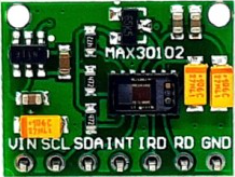

# Báo cáo chi tiết module breakout MAX30102 7 chân

**Đối tượng:** Board breakout 7 chân bán tại cửa hàng điện tử (PCB xanh, silkscreen `VIN SCL SDA INT IRD RD GND`)  
**Ảnh trong dự án:** `images/breakout-module-MAX30102-7-pinout.png`  
**Chip trên board:** MAX30102 (module quang 14 chân OESIP)  
**Tài liệu đi kèm:** `datasheets/MAX30102-BaoCao.md` (datasheet **chip**) và `datasheets/MAX30102.PDF`  
**MCU đích của đồ án:** ESP32 DevKit (`esp32doit-devkit-v1`, logic **3.3 V**)

> Tài liệu này mô tả **board carrier / breakout**, không thay thế datasheet chip. Thanh ghi, FIFO, MODE, ADC vẫn theo `MAX30102-BaoCao.md`. Phần dưới tập trung: pinout 7 chân, nguồn, I2C, linh kiện sẵn có, đấu dây ESP32, lỗi clone, và những gì **cần / không cần** thêm.

---

## Mục lục

1. [Chip datasheet khác breakout như thế nào](#1-chip-datasheet-khác-breakout-như-thế-nào)
2. [Nhận diện board trong ảnh dự án](#2-nhận-diện-board-trong-ảnh-dự-án)
3. [Tên gọi thương mại và biến thể](#3-tên-gọi-thương-mại-và-biến-thể)
4. [Thành phần trên PCB](#4-thành-phần-trên-pcb)
5. [Sơ đồ khối nguồn và tín hiệu](#5-sơ-đồ-khối-nguồn-và-tín-hiệu)
6. [Pinout 7 chân — chức năng từng chân](#6-pinout-7-chân--chức-năng-từng-chân)
7. [Điện áp cấp nguồn cho breakout](#7-điện-áp-cấp-nguồn-cho-breakout)
8. [Pad chọn mức logic I2C (1.8 V / 3.3 V)](#8-pad-chọn-mức-logic-i2c-18-v--33-v)
9. [Giao thức I2C — cách nối dây](#9-giao-thức-i2c--cách-nối-dây)
10. [Chân INT](#10-chân-int)
11. [Chân IRD và RD — vì sao để trống](#11-chân-ird-và-rd--vì-sao-để-trống)
12. [Board đã đủ linh kiện chưa? Cần thêm gì?](#12-board-đã-đủ-linh-kiện-chưa-cần-thêm-gì)
13. [Sơ đồ đấu ESP32 cho đồ án](#13-sơ-đồ-đấu-esp32-cho-đồ-án)
14. [Lỗi thiết kế clone thường gặp](#14-lỗi-thiết-kế-clone-thường-gặp)
15. [Nhầm MAX30100 / MAX30102 cùng 7 chân](#15-nhầm-max30100--max30102-cùng-7-chân)
16. [Cơ khí, quang học, cách đặt ngón tay](#16-cơ-khí-quang-học-cách-đặt-ngón-tay)
17. [Thử nghiệm phần cứng bắt buộc](#17-thử-nghiệm-phần-cứng-bắt-buộc)
18. [Checklist triển khai đồ án](#18-checklist-triển-khai-đồ-án)
19. [Tóm tắt “nhớ thuộc”](#19-tóm-tắt-nhớ-thuộc)

---

## 1. Chip datasheet khác breakout như thế nào

| Hạng mục | Chip MAX30102 (PDF) | Breakout 7 chân (ảnh) |
| --- | --- | --- |
| Hình dạng | Package quang 14 chân, ~5.6 × 3.3 × 1.55 mm | PCB ~14 × 14 mm, header 7 pin |
| Nguồn user phải cấp | **Hai rail:** VDD 1.8 V **và** VLED+ 3.1–5.25 V | **Một chân VIN** (LDO + nối LED trên board) |
| Giao tiếp | SCL, SDA, INT trực tiếp chip | Cùng tên ra header; thường có pull-up sẵn |
| LED driver | Chân `R_DRV`, `IR_DRV` | Ra header tên **RD**, **IRD** — user **không nối** |
| Tụ bypass, LDO, pull-up | Phải tự thiết kế | Đã hàn sẵn trên PCB |
| Firmware / thanh ghi | Áp dụng 100% | Áp dụng 100% (vẫn là chip đó) |

Kết luận: PDF phục vụ **silicon**. Board shop phục vụ **cắm dây nhanh**. Đồ án dùng **cả hai**: đấu dây theo breakout, lập trình theo datasheet.

---

## 2. Nhận diện board trong ảnh dự án



Ảnh `breakout-module-MAX30102-7-pinout.png` khớp **đúng** loại bán lẻ phổ biến:

- PCB **xanh lá**, chữ **MAX30102**
- Ở giữa: **cửa sổ quang đen** = package MAX30102 (LED đỏ + IR + photodiode + kính phủ **nằm trong chip**, không phải LED rời)
- Hai tụ tantalum **vàng** hai bên chip (lọc nguồn)
- IC SOT-23 nhỏ = **LDO 1.8 V** (và đôi khi thêm LDO 3.3 V trên biến thể khác)
- Hàng 7 pad/header cạnh board, silkscreen trái → phải:

```text
VIN   SCL   SDA   INT   IRD   RD   GND
```

Đây **không** phải SparkFun Qwiic / Analog Devices EV-kit. Đây là clone kiểu **GY-MAX30102 / CJMCU / RCWL-0531** (layout 7 chân thừa hưởng MAX30100).

---

## 3. Tên gọi thương mại và biến thể

Cùng chip, shop có thể dán nhãn:

| Tên hay gặp | Ghi chú |
| --- | --- |
| GY-MAX30102 | Tên phổ biến nhất, PCB ~14 × 14 mm |
| CJMCU-30102 | Cùng form 7 chân |
| RCWL-0531 | Đời sau RCWL-0530 (MAX30100); thường có **pad chọn 1.8/3.3 V** cho pull-up |
| Board đen “level shifter” | Thêm MOSFET dịch mức I2C; đắt hơn, dễ dùng với Arduino 5 V |
| Board MAX30100 7 chân | **Cùng thứ tự chân** — dễ mua nhầm |

Kích thước niêm yết thường: **~14 × 14 × 4.5 mm**, lỗ bắt vít Ø ~3 mm, khoảng cách lỗ ~9 mm (tùy lô).

---

## 4. Thành phần trên PCB

Trên một breakout 7 chân “đủ dùng”, ngoài chip còn:

| Linh kiện | Vai trò |
| --- | --- |
| **MAX30102** | Cảm biến quang + ADC + FIFO + I2C |
| **LDO 1.8 V** (thường XC6206P182 / ME6211-1.8 / tương đương) | Hạ VIN → **VDD chip 1.8 V** (chip **cấm** 3.3 V thẳng vào VDD) |
| Tụ tantalum / MLCC (vài µF đến 10 µF) | Bypass **VDD** và **VLED+/VIN** — datasheet yêu cầu ≥ 1 µF sát chân LED |
| Điện trở **~4.7 kΩ** (thường 3 con) | Pull-up **SDA, SCL, INT** |
| (Một số bản) **LDO 3.3 V** | Khi VIN = 5 V, tạo 3.3 V cho LED hoặc cho pull-up |
| (Một số bản) **pad 3 điểm** `1.8V – NC – 3.3V` | Chọn điện áp kéo I2C/INT |
| Header 2.54 mm 7 chân | Ra ngoài MCU |

**Không có trên board (và không cần cho đo cơ bản):**

- LED đỏ/IR rời (đã trong chip)
- Photodiode rời
- Crystal / oscillator (clock trong chip)
- EEPROM, MCU phụ
- Level shifter (trừ bản PCB đen)

---

## 5. Sơ đồ khối nguồn và tín hiệu

Kiến trúc **điển hình** board xanh 7 chân (một LDO):

```text
                    ┌─────────────────────────────────────────┐
   VIN ─────────────┤                                         │
      │             │  VLED+ của MAX30102  (thường nối VIN)   │
      │             │                                         │
      └── LDO 1.8V ─┤  VDD chip (1.8 V)                       │
                    │                                         │
   SCL ──┬── 4.7k ──┤  (kéo lên 1.8 V hoặc 3.3 V tùy pad)     │
   SDA ──┼── 4.7k ──┤  SCL / SDA / INT của chip               │
   INT ──┴── 4.7k ──┤                                         │
                    │                                         │
   IRD ─────────────┤  IR_DRV (cathode LED IR nội)            │
   RD  ─────────────┤  R_DRV  (cathode LED đỏ nội)            │
   GND ─────────────┤  GND + PGND (thường đã chung trên PCB)  │
                    └─────────────────────────────────────────┘
```

- User **chỉ cấp VIN + GND**.
- Chip tự xung LED; dòng xung đỉnh có thể **vài chục mA** trên VIN — nguồn ESP32 3V3 đủ nếu dây ngắn, tụ trên board tốt.
- GND analog và PGND datasheet tách; trên breakout **đã chung** một mặt đồng.

Biến thể hai LDO (một số lô / bài sửa board sai): VIN → 3.3 V → 1.8 V; LED lấy 3.3 V thay vì VIN thô.

---

## 6. Pinout 7 chân — chức năng từng chân

Thứ tự **theo silkscreen ảnh dự án** (nhìn chữ, chân từ trái sang phải):

| # | Tên | Hướng | Kết nối bên trong | Bắt buộc với ESP32? |
| --- | --- | --- | --- | --- |
| 1 | **VIN** | Nguồn vào | LDO 1.8 V + thường **VLED+** | **Có** |
| 2 | **SCL** | Vào (clock I2C) | Pin 2 chip, open-drain bus | **Có** |
| 3 | **SDA** | Vào/ra I2C | Pin 3 chip, open-drain | **Có** |
| 4 | **INT** | Ra, active-low, open-drain | Pin 13 chip | **Khuyến nghị** (có thể bỏ lúc prototyping) |
| 5 | **IRD** | Driver LED IR | Pin 6 `IR_DRV` | **Không nối** |
| 6 | **RD** | Driver LED đỏ | Pin 5 `R_DRV` | **Không nối** |
| 7 | **GND** | Mass | GND + PGND | **Có** |

### 6.1. VIN

- Nguồn **duy nhất** user cấp cho cả logic 1.8 V (qua LDO) và LED.
- Không phải chân VDD 1.8 V của chip — **không** đo 1.8 V trên VIN.
- Trên ESP32: nối **3V3**, không nối 5 V (xem mục 7).

### 6.2. SCL

- Clock I2C, master (ESP32) tạo xung.
- Open-drain: phải có pull-up (board thường đã có).
- Tối đa **400 kHz** (Fast-mode), datasheet.

### 6.3. SDA

- Data I2C hai chiều, open-drain.
- Cùng bus với thiết bị I2C khác nếu địa chỉ không trùng (MAX30102 **cố định 0x57**).

### 6.4. INT

- Ngắt **mức thấp**. IDLE = HIGH nhờ pull-up; sự kiện → kéo LOW đến khi firmware đọc/xóa status.
- Open-drain, abs max tới ~5 V về GND (chip), nhưng **mức HIGH thực tế = điện áp pull-up trên board**.
- Dùng GPIO ESP32 cấu hình input, **falling edge**, pull-up nội **tắt** nếu đã có 4.7 kΩ ngoài (tránh song song quá thấp).

### 6.5. IRD

- `IR_DRV`: cathode / chân driver LED hồng ngoại **bên trong package**.
- LED đã nối nội; firmware chỉnh dòng qua thanh ghi `LED2_PA` (0x0D), **không** PWM GPIO vào IRD.
- Để **nổi (NC)**. Không GND, không 3.3 V.

### 6.6. RD

- `R_DRV`: tương tự cho LED đỏ; thanh ghi `LED1_PA` (0x0C).
- Để **NC**.

> Một số tài liệu shop ghi “IRD/RD = cathode LED, nối GND”. **Sai với cách dùng breakout.** Nối GND hai chân này có thể làm LED không điều khiển đúng / hỏng driver.

### 6.7. GND

- Chung mass với ESP32 **bắt buộc**.
- Không dùng GND riêng “cảm biến” nếu không nối với GND MCU — I2C sẽ chết.

---

## 7. Điện áp cấp nguồn cho breakout

### 7.1. Hai rail bên trong chip (nhắc lại)

| Rail chip | Dải hợp lệ | Ai tạo trên breakout? |
| --- | --- | --- |
| VDD | **1.7 – 2.0 V** (typ 1.8 V) | LDO trên PCB |
| VLED+ | **3.1 – 5.25 V** | Thường **chính VIN** |

VDD chip **không bao giờ** được 3.3 V (abs max 2.2 V). Breakout tồn tại chính vì LDO 1.8 V.

### 7.2. VIN do user cấp — khoảng thực tế

Niêm yết shop lẫn lộn (1.8–5 V, 3–5 V, 3.3–5.5 V). Thực tế:

| VIN | Logic 1.8 V | LED (VLED+ ≈ VIN) | ESP32 |
| --- | --- | --- | --- |
| 1.8 V | LDO dropout, VDD có thể sai | **Dưới 3.1 V** — LED yếu / không đạt spec | Không khuyến nghị |
| **3.3 V** | LDO ổn | Đạt min VLED+ | **Khuyến nghị đồ án** |
| 5 V | LDO ổn | LED mạnh, headroom tốt | **Nguy hiểm:** pull-up I2C nếu dính VIN 5 V **đốt GPIO ESP32** |

**Quy tắc đồ án ESP32:** cấp **VIN = 3.3 V** từ chân `3V3` DevKit, GND chung.

Dòng:

- Logic chip đo SpO2/HR: cỡ **0.6 – 1.2 mA** (datasheet, PW 215 µs, 50 sps) trên VDD
- LED: xung, trung bình thấp, **đỉnh** có thể lớn (datasheet mạch mẫu ghi tới hàng trăm mA đỉnh trên 5 V). ESP32 3V3 thường chịu được đo ngón tay dòng LED vừa (vài–vài chục mA trung bình). Tránh `LED_PA = 0xFF` (50 mA) khi nguồn yếu.

### 7.3. Đo kiểm tra bằng đồng hồ

Sau khi cấp VIN = 3.3 V:

1. VIN–GND ≈ 3.3 V
2. Chân ra LDO 1.8 V (pad chip VDD, hoặc pad đánh dấu 1.8 V) ≈ **1.8 V**
3. Nếu LDO ra ~2.8 V / 3.3 V: **sai loại LDO** — lỗi clone kinh điển, chip có thể hỏng hoặc hoạt động sai

---

## 8. Pad chọn mức logic I2C (1.8 V / 3.3 V)

Nhiều board (RCWL-0531 và clone) có **3 pad hàn** chọn điện áp kéo SDA/SCL/INT:

```text
 [ 1.8V ] ── [ jumper ] ── [ 3.3V ]
```

| Jumper | HIGH của I2C/INT | MCU phù hợp |
| --- | --- | --- |
| Về **1.8 V** | ~1.8 V | MCU 1.8 V; **ESP32 thường không nhận HIGH** (VIH ~ 0.75×3.3 ≈ 2.5 V) |
| Về **3.3 V** (mặc định bản tốt) | ~3.3 V | **ESP32, Arduino 3.3 V** |
| Về VIN khi VIN = 5 V | 5 V | Arduino Uno; **cấm ESP32** |

Datasheet chip: VIH = 0.7×VDD với VDD = 2 V → ngưỡng **phía MAX30102** thấp (~1.4 V). Chip **đọc** được 3.3 V trên SDA/SCL (abs max chân I/O tới 6 V). Vấn đề là **chiều ngược**: MCU 3.3 V **đọc** SDA khi slave kéo lên chỉ 1.8 V.

**Việc phải làm khi nhận board:**

1. Xác định pull-up đang nối 1.8 V hay 3.3 V (multimeter: điện trở SDA–1.8V vs SDA–3.3V/VIN).
2. Với ESP32: pull-up phải **3.3 V**.
3. Nếu đang 1.8 V: chuyển jumper / cắt đường 1.8 V rồi bắc sang 3.3 V (cách sửa board “sai pull-up”).

Không có pad: xem mục 14.

---

## 9. Giao thức I2C — cách nối dây

### 9.1. Thông số bus

| Thông số | Giá trị |
| --- | --- |
| Chuẩn | I2C / SMBus tương thích |
| Tốc độ | 100 kHz (Standard) hoặc **400 kHz** (Fast) — đồ án nên 400 kHz khi đọc FIFO |
| Địa chỉ 7-bit | **`0x57`** (Arduino `Wire`, ESP-IDF) |
| Địa chỉ 8-bit | Ghi `0xAE`, đọc `0xAF` |
| Part ID (0xFF) | **`0x15`** = đúng MAX30102 |
| SDA/SCL | Open-drain, **chung GND**, pull-up về mức MCU |
| Chiều dài dây | Ngắn (vài cm–<20 cm); dây dài cần giảm tốc độ / pull-up mạnh hơn |

### 9.2. Vì sao “chỉ 2 dây tín hiệu”

I2C chỉ cần SDA + SCL (+ GND + nguồn). INT không thuộc I2C; IRD/RD không thuộc I2C.

Tối thiểu 4 dây:

```text
ESP32 3V3  →  VIN
ESP32 GND  →  GND
ESP32 SDA  →  SDA     (DevKit mặc định GPIO21)
ESP32 SCL  →  SCL     (DevKit mặc định GPIO22)
```

Đủ để scan I2C thấy `0x57` và đọc ADC. INT thêm để không poll liên tục.

### 9.3. Pull-up — board đã có thì không thêm mặc định

- Board tốt: 3 × 4.7 kΩ trên SDA, SCL, INT.
- Bus Fast-mode 400 kHz: datasheet thư viện thường yêu cầu **≤ 4.7 kΩ**.
- Nhiều thiết bị I2C **cùng** có pull-up → R song song quá nhỏ, dòng sink lớn. Nếu bus đã có 4.7 kΩ trên MAX30102, **đừng** hàn thêm 4.7 kΩ ngoài trừ khi đo SDA không lên HIGH.
- ESP32 `Wire` có pull-up nội yếu (~45 kΩ): thường **không thay** 4.7 kΩ ngoài; để nguyên.

### 9.4. Không cần UART/SPI/PWM

Breakout **không** xuất analog PPG ra chân. Mọi mẫu đi I2C thanh ghi `FIFO_DATA` (0x07). Không nối ADC ESP32 vào IRD/RD.

### 9.5. Nhiều slave trên một bus

MAX30102 cố định `0x57`. Có thể chung SDA/SCL với OLED SSD1306, EEPROM, v.v. nếu địa chỉ khác. INT **riêng từng module**.

---

## 10. Chân INT

| Thuộc tính | Chi tiết |
| --- | --- |
| Kiểu | Open-drain, **active-low** |
| Pull-up | ~4.7 kΩ trên board (nếu có) |
| Khi nào LOW | FIFO almost full, PPG ready, ALC overflow, proximity, nhiệt xong, power-ready (xem báo cáo chip) |
| Firmware | Đọc `0x00`/`0x01` hoặc thanh ghi nguồn để xóa |

**Có thể không nối INT:** firmware poll FIFO pointer — đơn giản, tốn CPU, dễ trễ.

**Nên nối INT cho đồ án:** GPIO bất kỳ có EXTI (ví dụ GPIO4, GPIO5, GPIO15 — tránh strapping nếu không hiểu: GPIO0/2/12/15 lúc boot).

Cấu hình: `INPUT`, ngắt **FALLING**, không pull-up nội nếu đã có ngoài.

---

## 11. Chân IRD và RD — vì sao để trống

Trong package MAX30102, LED đỏ/IR **đã nối** tới driver nội. Breakout đưa `IR_DRV`/`R_DRV` ra header chủ yếu vì:

1. Layout cũ MAX30100 cũng 7 chân, shop giữ nguyên.
2. Debug / đo dạng xung LED (oscilloscope) — không cần cho đồ án.

**Đồ án: không hàn dây IRD, RD.**

Điều khiển LED: ghi `0x0C` (Red), `0x0D` (IR), `0x10` (PILOT).

---

## 12. Board đã đủ linh kiện chưa? Cần thêm gì?

### 12.1. Đã có trên breakout (không cần lặp)

- Chip MAX30102 + kính quang
- LDO 1.8 V
- Tụ bypass nguồn
- Pull-up I2C/INT (hầu hết lô)
- Header 7 chân

### 12.2. Bắt buộc ngoài board

| Thứ | Lý do |
| --- | --- |
| ESP32 + USB | MCU đồ án |
| 4 dây: VIN, GND, SDA, SCL | Tối thiểu |
| Nguồn 3.3 V ổn | Từ DevKit |
| GND chung | I2C |

### 12.3. Khuyến nghị thêm (không bắt buộc để “sống”)

| Thứ | Khi nào |
| --- | --- |
| 1 dây INT | Đọc FIFO theo ngắt |
| Tụ 10–100 µF gần VIN–GND nếu dây nguồn dài | Giảm sụt áp khi LED xung |
| Ốp ngón tay / xốp che sáng | SNR, giảm ALC_OVF |
| Màn hình / Bluetooth | Phần ứng dụng, không phải cảm biến |

### 12.4. Không cần

- Level shifter **nếu** VIN = 3.3 V và pull-up = 3.3 V (ESP32)
- Điện trở pull-up thêm **nếu** board đã 4.7 kΩ và bus sạch
- Driver LED ngoài, MOSFET LED
- Crystal
- Nguồn 1.8 V rời

### 12.5. Ngoại lệ phải thêm / sửa

- Pull-up đang 1.8 V → ESP32 không thấy máy: sửa jumper hoặc **tháo 3 pull-up board**, kéo 4.7 kΩ ra **3V3 ESP32**
- Arduino Uno 5 V + board xanh không shifter: cân nhắc shifter hoặc kéo I2C 5 V (chip chịu được; **không** làm vậy với ESP32)
- LDO ra sai 2.8 V: thay LDO 1.8 V đúng mã (`…P18…`)

---

## 13. Sơ đồ đấu ESP32 cho đồ án

Board: **ESP32 DevKit V1** (`esp32doit-devkit-v1`), I2C mặc định Arduino-ESP32:

| Breakout | ESP32 DevKit V1 | Ghi chú |
| --- | --- | --- |
| **VIN** | **3V3** | Không dùng pin `5V` / `VIN` 5 V của DevKit |
| **GND** | **GND** | Chung mass |
| **SDA** | **GPIO21** | `Wire` mặc định |
| **SCL** | **GPIO22** | `Wire` mặc định |
| **INT** | GPIO4 (ví dụ) | Tùy chọn; INPUT, FALLING |
| **IRD** | — | Để trống |
| **RD** | — | Để trống |

```text
ESP32 DevKit V1                     MAX30102 breakout 7 chân
────────────────                    ─────────────────────────
         3V3  ────────────────────►  VIN
         GND  ────────────────────►  GND
      GPIO21  ────────────────────►  SDA
      GPIO22  ────────────────────►  SCL
      GPIO4   ────────────────────►  INT     (khuyến nghị)
                     (nổi)           IRD
                     (nổi)           RD
```

`platformio.ini` hiện `monitor_speed = 115200` — Serial debug, không liên quan MAX30102.

Đổi chân I2C: `Wire.begin(SDA, SCL);` — vẫn 3.3 V, dây ngắn.

**Cắm ngược VIN/GND** dễ chết LDO/chip. Khớp silkscreen **VIN … GND** trước khi cấp nguồn.

---

## 14. Lỗi thiết kế clone thường gặp

Các lỗi này **không có trong datasheet Maxim**; rất hay gặp hàng shop VN.

### 14.1. Pull-up I2C kéo 1.8 V (nặng nhất)

Triệu chứng: I2C scan **không thấy 0x57**, hoặc thấy lúc được lúc không; logic analyzer SDA HIGH chỉ ~1.8 V.

Sửa: jumper 3.3 V, hoặc cắt trace 1.8 V, bắc pull-up sang 3.3 V / VIN 3.3 V; hoặc tháo 3 resistor, kéo ngoài về 3V3 MCU.

### 14.2. LDO ghi 1.8 V nhưng silicon 2.8 V / 3.3 V

VDD chip > 2.0 V: ngoài spec, rủi ro hỏng, count ADC sai.

Đo pad 1.8 V. Sai → thay XC6206P**18**2 (số `18` = 1.8 V).

### 14.3. VLED+ nối VIN nhưng VIN = 3.3 V, LED_PA quá lớn

Headroom LED đỏ (VF ~2.1 V @ 20 mA; 50 mA cần cao hơn). Giảm `LED_PA`, hoặc chấp nhận 3.3 V với dòng vừa.

### 14.4. In MAX30102 nhưng gắn MAX30100

Cùng 7 chân. Thanh ghi/FIFO khác. Đọc `0xFF`:

- **0x15** → MAX30102 (đúng tài liệu chip của đồ án)
- Khác / NACK → sai chip, sai dây, hoặc chết I2C

### 14.5. Không có pull-up trên board

SDA/SCL “mềm”, không ACK. Hàn 4.7 kΩ SDA–3V3 và SCL–3V3, INT–3V3.

---

## 15. Nhầm MAX30100 / MAX30102 cùng 7 chân

| | MAX30100 breakout | MAX30102 breakout (đồ án) |
| --- | --- | --- |
| Silkscreen chân | Thường giống: VIN SCL SDA INT IRD RD GND | Giống |
| Chip nhìn | Cũng cửa sổ đen | Cũng cửa sổ đen — **không đoán bằng mắt** |
| PART_ID | Khác map thanh ghi | **0x15** |
| FIFO / ADC | 16-bit, khác register | 18-bit, map `MAX30102-BaoCao.md` |
| Kính phủ | Không / khác | Có cover glass trong package |

Firmware SparkFun MAX3010x (`MAX30105.h`) thường detect MAX30102. Thư viện MAX30100 **không** thay thế được.

---

## 16. Cơ khí, quang học, cách đặt ngón tay

- Đo **phản xạ**: cửa sổ hướng **lên**, ngón **áp nhẹ** lên kính (không bóp trắng đầu ngón).
- Khe hở / trượt / nói chuyện / gõ bàn → artifact. ALC_OVF khi đèn mạnh / nắng.
- Che cạnh module (in 3D, mút) giảm lọt sáng.
- Mồ hôi, bẩn kính → lau khô.
- Cổ tay (smartwatch) khó hơn ngón tay trên breakout phẳng không có cơ cấu áp lực.

Lỗ vít: bắt cố định, tránh bẻ header làm nứt pad.

---

## 17. Thử nghiệm phần cứng bắt buộc

Thứ tự gợi ý:

1. **Chưa nối ESP32:** nhìn silkscreen VIN…GND, không chập IRD/RD.
2. Cấp 3.3 V–GND, đo LDO **1.8 V**.
3. Đo SDA (idle) so với GND: ~**3.3 V** (không phải 1.8 V) nếu pull-up đúng.
4. Nối I2C, chạy **I2C scanner** → `0x57`.
5. Đọc `0xFF` → `0x15`.
6. Reset chip, bật SpO2, đọc FIFO: count Red/IR đổi khi che/áp ngón.
7. (Sau) INT: GPIO bắt cạnh xuống khi FIFO almost full.

Chưa qua bước 4–5 thì **chưa** viết thuật toán BPM/SpO2.

---

## 18. Checklist triển khai đồ án

### **Đấu dây**

- [ ] VIN → ESP32 **3V3** (không 5 V)
- [ ] GND chung
- [ ] SDA → GPIO21, SCL → GPIO22 (hoặc cặp đã `Wire.begin`)
- [ ] IRD, RD **nổi**
- [ ] INT → GPIO, nếu dùng ngắt

### **Board**

- [ ] Pull-up I2C = **3.3 V**, không 1.8 V
- [ ] LDO ra **1.8 V**
- [ ] PART_ID `0x15`

**Firmware** (chi tiết thanh ghi: `MAX30102-BaoCao.md`)

- [ ] I2C 100 hoặc 400 kHz
- [ ] Không giả định analog PPG trên header
- [ ] Xóa FIFO trước khi MODE SpO2/HR
- [ ] LED_PA vừa phải trên 3.3 V

### **Hệ thống**

- [ ] Dây ngắn, tiếp xúc chắc
- [ ] Hướng dẫn user: áp ngón yên 5–10 s
- [ ] Ghi rõ: **không phải thiết bị y tế**

---

## 19. Tóm tắt “nhớ thuộc”

```text
Board 7 chân = chip MAX30102 + LDO 1.8 V + tụ + pull-up I2C
VIN = 3.3 V (ESP32)     GND chung
SDA/SCL = I2C 0x57      PART_ID 0x15
INT = ngắt active-low   (nên có)
IRD / RD = KHÔNG NỐI
Không cần shifter, không cần 1.8 V rời, không cần LED ngoài
Cấm VIN = 5 V vào ESP32 nếu pull-up dính 5 V
Nếu scan I2C fail → nghi pull-up 1.8 V trước khi nghi code
Lập trình thanh ghi → file MAX30102-BaoCao.md
```

---

## Phụ lục A — So sánh “đủ / thiếu” cho đồ án

| Nhu cầu | Breakout 7 chân đáp ứng? |
| --- | --- |
| Đo PPG Red + IR thô | Có (I2C) |
| Tự ra số BPM / SpO2 đã hiệu chuẩn y tế | **Không** — phải viết/thuật toán + hiểu đây là wellness |
| Cắm ESP32 3.3 V | Có, **nếu** pull-up 3.3 V |
| Pin, wearable tối ưu | Trung bình (LDO tổn hao; đủ đồ án) |
| Tách VLED+ 5 V / VDD 1.8 V như datasheet lý tưởng | Thường **không** — LED ăn VIN 3.3 V |

## Phụ lục B — Tài liệu tham chiếu

- Analog/Maxim **MAX30102** datasheet Rev 0 (file `MAX30102.PDF`)
- Báo cáo chip: `MAX30102-BaoCao.md`
- Ảnh board: `images/breakout-module-MAX30102-7-pinout.png`
- Kiến thức cộng đồng về clone: RCWL-0530/0531 (pull-up 1.8 V), GY-MAX30102, sửa LDO/jumper — **không** thay datasheet, chỉ giải thích hàng shop

---

*Viết cho đồ án ESP32 + module 7 chân cửa hàng. Lô PCB khác nhau; luôn đo 1.8 V, idle SDA và PART_ID trước khi tin silkscreen.*
